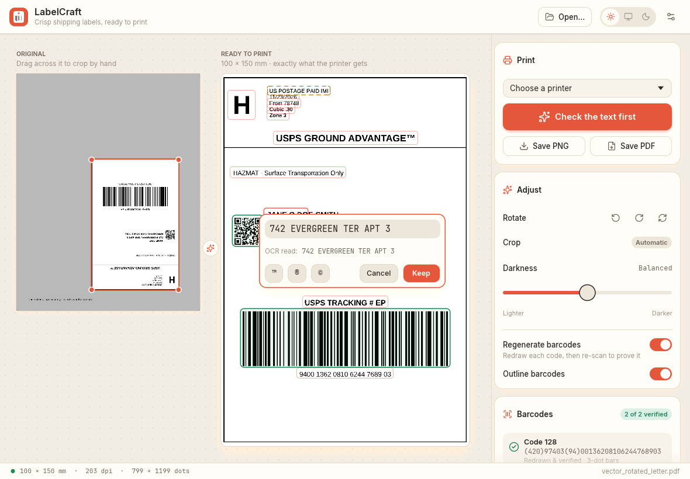
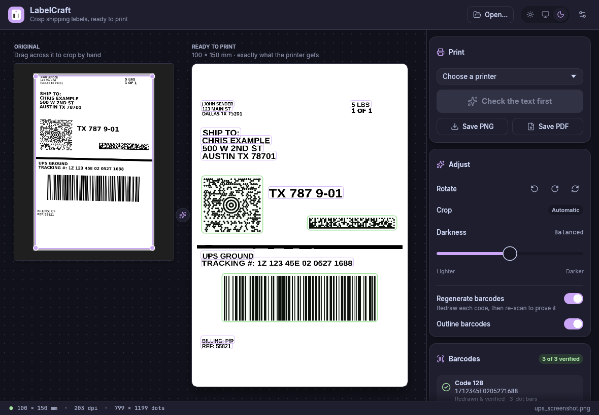
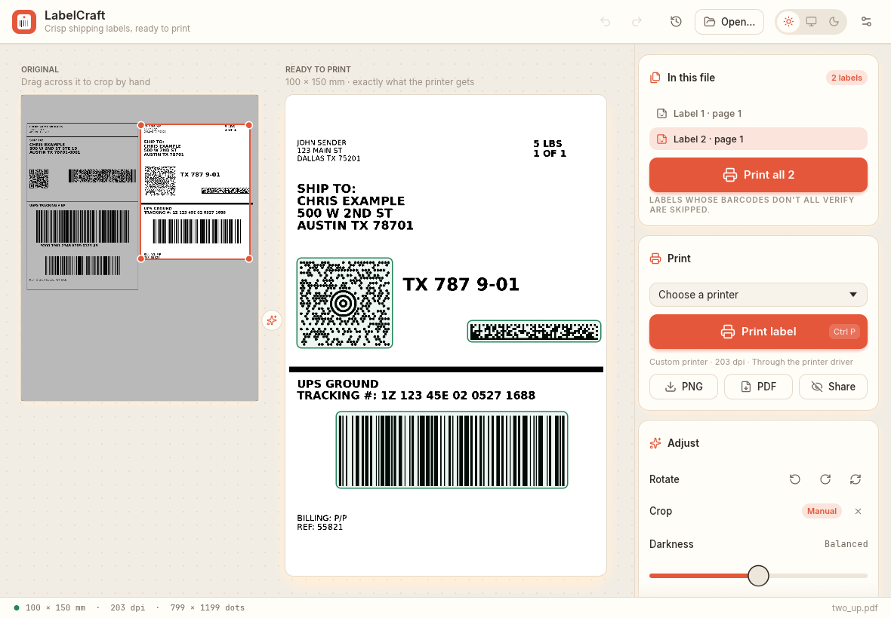
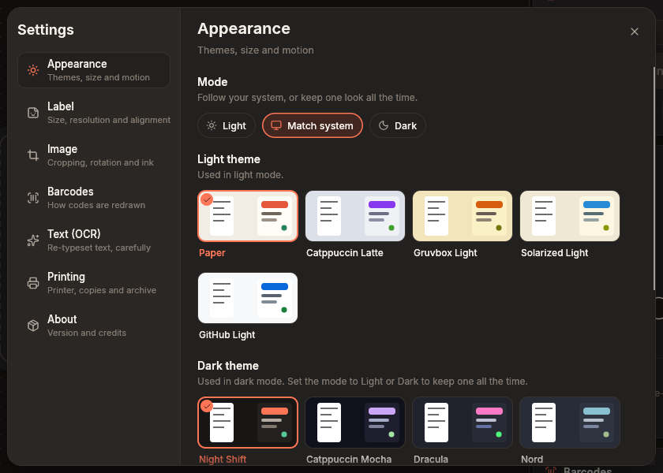

# LabelCraft

Drop in a shipping label (PDF, PNG, or JPG) and get a print-ready 4 × 6 label for a thermal
printer (built for the PeriPage PB41, with profiles for Zebra, Rollo, MUNBYN, DYMO and other
popular shipping printers). Then print it straight from the app. Windows, macOS and Linux.

<p>
  
  
</p>

*LabelCraft 0.3 in the Paper and Night Shift themes, shown with a made-up test label. It follows your system setting, or pick a mode with the sun / monitor / moon switch and choose from 15 themes in Settings.*

## Download

Get the latest from [Releases](https://github.com/civarson/labelcraft/releases/latest):

- **Windows:** `labelcraft-windows-x64-setup.exe` installs LabelCraft just for you (no admin
  rights) into `AppData\Local\Programs\LabelCraft`, with a Start menu shortcut and, if you
  like, a desktop shortcut and "Open with" for PDFs and images. Prefer no installer? The
  `.zip` has the portable `LabelCraft.exe`. Windows SmartScreen warns about both because
  they aren't code-signed: **More info → Run anyway**.
- **macOS (Apple Silicon and Intel):** `labelcraft-macos-universal.zip`. Right-click
  `LabelCraft.app` and choose **Open** the first time.
- **Linux (x86_64):** the `.AppImage` (`chmod +x` and run) or the `.tar.gz`.

## What it does

1. **Finds the label on the page.** It handles letter-size PDFs with instructions, labels
   with a printed border, screenshots on a dark background, and plain 4×6 pages. You can
   also drag a box on the original to crop by hand.
2. **Straightens and orients it.** It corrects small skews and turns the label so the main
   barcode reads left-to-right in portrait, including upside-down and landscape sources.
3. **Fits it to the printer's dot grid.** The output is exactly 799 × 1199 dots, converted
   to clean black and white. PDFs are redrawn straight onto that grid from their vector
   content (fonts, lines, barcodes), rotation and all, so text edges land exactly on dots
   instead of being resampled. Images use an adaptive cut-off so faint text survives.
4. **Regenerates the barcodes.** Every barcode that decodes is re-encoded from its exact
   data and redrawn with whole-dot module widths. That covers Code 128 (including
   GS1-128/USPS IMpb), PDF417 (FedEx), MaxiCode (UPS), Data Matrix, QR, and Aztec.
   A new barcode is only kept if it scans back to identical data: the same raw bytes,
   the same symbology identifier, and the same GS1 structure. If it doesn't, the
   original is restored and the panel shows why.
5. **Prints.** On Windows it prints through GDI at the driver's real resolution. On macOS
   and Linux it sends an exact-size PDF to CUPS with scaling turned off. Printers that
   speak ZPL or TSPL can optionally get the label directly in their own language
   (see *Printers* below).

6. **Optionally re-typesets text (off by default).** For blurry images and scans, *Text
   (OCR)* in Settings reads each line and redraws it in Liberation Sans. Because a misread
   ZIP code or house number misroutes a package, a line is only redrawn when:
   - two separate reads (high-resolution and print-resolution) agree exactly,
   - both are confident (90% by default, adjustable),
   - any long number in it matches a barcode's data, and
   - the redrawn line reads back as exactly the same text.

   Every other line keeps its original pixels. When anything was redrawn, **Print** turns
   into **Check the text first**: hold *Original* to compare, then click *Looks right*.
   PDFs don't need OCR: step 3 already draws their real text.

   With OCR on, **click any line on the label to edit it in place**. Your text is drawn at
   the line's size and weight, grows into blank space beside it (or squeezes, down to 70%),
   and is read back to check it. Numbers that are also in a barcode (like the ZIP) can't be
   changed. A tracking number (a long number found in a barcode) opens a **double-check
   dialog** when you change it, or when LabelCraft redrew it while less than 90% sure. Lines
   left as original print never ask. The dialog shows the original print, what will print, and whether
   it matches the barcode, and Print waits until you confirm. Edits can be undone one by one
   or all at once from the *Text* card.

<p align="center"> </p>

<p align="center"></p>

## Using it

- Drag a file onto the window, click the drop zone, use **Open…** (Ctrl/⌘-O), paste a
  screenshot or a copied file (Ctrl/⌘-V), or pick one from **Recent** (clock icon)
- **Watch a folder:** turn on *Settings → Printing → Watch a folder* and new labels in
  Downloads (or any folder) open by themselves. Together with *Print as soon as a label is
  ready*, buying a label is: download, and it prints, but only if every barcode verifies.
- **Several labels in one file:** two-up sheets, multi-page PDFs and labels with a packing
  slip beside them are listed under **In this file**. Click one to check it, or
  **Print all**. Labels whose barcodes don't all verify are skipped.
- **Share** saves a copy with every text line and barcode blurred, for bug reports and
  screenshots.
- Check the **Barcodes** list. Green means regenerated and verified. Amber means the
  original was kept, with the reason. If a barcode on the original isn't listed at all,
  it couldn't be read from the source.
- Pick the printer once (it's remembered), then click **Print label** (or press Ctrl/⌘-P).
- **Settings** (gear, top right, or Ctrl/⌘-,):
  - **Appearance:** 15 colour themes, picked separately for light and dark mode (Paper,
    Night Shift, Catppuccin Latte and Mocha, Dracula, Nord, Gruvbox Light and Dark,
    Solarized Light and Dark, Tokyo Night, Rosé Pine, One Dark, GitHub Light and Dark),
    interface size, reduce motion
  - **Label:** size presets (4×6, A6, 4×4, 4×3, 4×2, 2.25×1.25 in) or custom, 203/300 dpi,
    edge margin, an alignment nudge if prints come out shifted, and a **calibration
    page** (border on the outermost dots, millimetre rulers, print patterns) to set it
  - **Image:** automatic crop / straighten / rotate on or off, drawing PDFs at printer
    resolution, bolder text
  - **Barcodes:** regenerate on or off, prefer thicker bars
  - **Text (OCR):** opt-in re-typesetting and in-place editing, confidence needed, review before printing
  - **Printing:** printer and model, copies, direct printing, folder watching, packing
    slips, print automatically when a label is ready (only if every barcode verified and no
    text needs checking), save a PNG of every printed label and delete those after N days
  - **About:** update notice (asks GitHub once at start-up; off switch), and on Windows
    *Add to "Open with"* for PDF and image files

<p align="center"></p>

<p align="center"></p>
- Drag across the original to crop by hand; the **×** next to *Manual* goes back to automatic.

### PeriPage PB41 setup

- **Windows:** install the PeriPage driver. The app asks the driver for 100 × 150 mm
  portrait on every print. If the driver ignores custom sizes, set the default paper
  to 100 × 150 mm (or 4 × 6 in) in *Printing Preferences*.
- **Use the SD driver.** PeriPage's "HD" drivers print at 203 × 300 dpi, which stretches
  the image vertically; the SD driver (203 × 203 dpi) keeps barcodes on exact dots.
  (Thanks to [peripage-bridge](https://github.com/hayek/peripage-bridge) for documenting this.)
- **macOS:** install the PeriPage driver and add the printer. The app sends
  `media=Custom.100x150mm` with scaling off. If your driver names its 4×6 paper
  differently, enter it under *Extra CUPS options*, for example `media=<name>`.
  `lpoptions -p <printer> -l` lists the names.

## Printers

LabelCraft recognises the printer from its name and draws the label at that printer's real
resolution (203 or 300 dpi) and print width, so barcodes land exactly on its dots. You can
also pick the model by hand in *Settings → Printing*.

| Printer | Resolution | Direct printing | Status |
|---|---|---|---|
| PeriPage PB41 | 203 dpi | driver only | **tested** |
| Zebra (GK420d, ZD411/421, ZD620, ZSB…) | 203 / 300 dpi | ZPL | specs only |
| Rollo (USB / Wireless) | 203 dpi | driver | specs only |
| MUNBYN (ITPP941, RW401/403…) | 203 / 300 dpi | TSPL | specs only |
| iDPRT / Polono (SP410, SP420, PL420…) | 203 / 300 dpi | TSPL | specs only |
| Jadens, Nelko, Phomemo | 203 dpi | driver | specs only |
| DYMO LabelWriter 4XL / 5XL | 300 dpi | driver | specs only |
| Brother QL-1100 / QL-1110 | 300 dpi | driver | specs only |

"Specs only" means the profile comes from the manufacturer's specifications: nobody has
printed on that model with LabelCraft yet. A 300 dpi model is picked when the printer's
name contains "300" (Zebra drivers name themselves that way).

**Direct printing (experimental)** sends a ZPL or TSPL job straight to the printer instead
of going through its driver, which avoids driver scaling and margin quirks. It is off by
default. If you try it, *Settings → Printing → Save a test job* writes the job to a file,
and an issue saying what came out (fine, blank, inverted, upside down) helps a lot.

## Command line

```
labelcraft --cli input.pdf out.png              # writes out.png and out.pdf, prints the report
labelcraft --cli input.jpg out.png --no-regen   # clean-up only
labelcraft --cli input.jpg out.png --ocr        # also re-typeset text, listing each line's outcome
labelcraft --cli input.jpg out.png --ocr --edit "3=742 EVERGREEN TERRACE"   # retype line 3 by hand
labelcraft --cli input.pdf out.png --no-vector  # resample the PDF instead of drawing it at printer resolution
labelcraft --cli input.pdf out.png --dpi 300     # draw for a 300 dpi printer
labelcraft --cli input.pdf out.png --zpl out.zpl --tspl out.tspl   # also write printer-language jobs
labelcraft --cli input.pdf out.png --layout     # list every label / packing slip found per page
labelcraft --cli input.pdf out.png --share shareable.png   # blurred copy for sharing
labelcraft --cli input.pdf out.png --calibration cal.png   # calibration page at the label size
labelcraft --cli input.pdf out.png --print "PB41"
```

Set `LABELCRAFT_DEBUG=1` to dump intermediate images and verification crops.

## Design

LabelCraft's interface takes its cues from the open-source Crafting Apps, PhotoCraft and SolidCraft in particular. Like them, it is a native Rust app built on egui, set in Inter and JetBrains Mono, drawn with Lucide icons, and styled entirely from a small set of design tokens, with light and dark themes that can follow the system. The colours, components and the "kraft paper & stamp ink" look are LabelCraft's own: SolidCraft's look is covered by its own brand licence, so none of its theme, palette or UI kit is used here.

### Not affiliated

LabelCraft is an independent hobby project. It is **not affiliated with, endorsed by, or connected to** ArtCraft, PhotoCraft, SolidCraft or any of the other Crafting Apps or their maintainers. The "Craft" in the name and the design choices above are a fan's interpretation of the principles those projects share: native, local-first, open source, and pleasant to use. Seeing that those ideas scale so well to small FOSS tools like this one has been genuinely inspiring, and I'm grateful to the people behind them for building in the open.

## Building

You need Rust (stable), **CMake**, and a C++ compiler, because the zxing-cpp/zint barcode
engine is compiled from source.

- macOS: `xcode-select --install`, then `brew install cmake`
- Windows: Visual Studio Build Tools with *Desktop development with C++* (includes CMake)
- Linux: `build-essential` and `cmake` (Debian/Ubuntu); nothing else is needed to build

```
cargo build --release
```

The first build takes a few minutes (C++).

**Releases:** every push to `main` builds `LabelCraft.exe` (Windows x64, as an installer
and a portable zip), a universal
`LabelCraft.app` (Apple Silicon and Intel) and Linux x86_64 as an AppImage and a `.tar.gz`
on GitHub Actions. When the `version` in `Cargo.toml` doesn't have a release yet, the same
run publishes one (`v<version>`) with all of them attached, so to ship a new version, bump
the version and push.

The macOS app is ad-hoc signed. On first launch, right-click it and choose **Open**.

## Credits

- [Inter](https://rsms.me/inter/) and [JetBrains Mono](https://www.jetbrains.com/lp/mono/) fonts, SIL Open Font License 1.1 (`assets/fonts/OFL-*.txt`)
- [Lucide](https://lucide.dev) icons, ISC licence (`assets/icons/LICENSE-lucide.txt`)
- [Liberation Sans](https://github.com/liberationfonts/liberation-fonts) for re-typeset text, SIL Open Font License 1.1 (`assets/fonts/OFL-LiberationSans.txt`)
- Text recognition: [PaddleOCR](https://github.com/PaddlePaddle/PaddleOCR) PP-OCRv6 tiny models as packaged by [OnnxOCR](https://github.com/jingsongliujing/OnnxOCR), Apache 2.0 (`assets/ocr/`), run with [rten](https://github.com/robertknight/rten)
- Colour themes follow the published palettes of Catppuccin, Dracula, Nord, Gruvbox, Solarized, Tokyo Night, Rosé Pine, One Dark and GitHub's Primer
- Barcode reading and writing by [zxing-cpp](https://github.com/zxing-cpp/zxing-cpp) with [zint](https://zint.org.uk); PDF rendering by [hayro](https://github.com/LaurenzV/hayro); UI by [egui](https://github.com/emilk/egui)

## Layout

| File | Purpose |
|---|---|
| `src/pipeline.rs` | Loading (PDF via hayro, images with EXIF rotation), auto-crop, deskew, orientation, fit, PDF redraw at the dot grid, thresholding |
| `src/ocr.rs` | Opt-in OCR re-typesetting with double reads, barcode cross-checks and read-back verification |
| `src/barcodes.rs` | Detection, isolated-blob second pass, exact re-encoding, verification and rollback |
| `src/print.rs` | Windows GDI printing, CUPS `lp` on macOS/Linux, raw jobs to either |
| `src/extras.rs` | Calibration page, shareable copy, folder watcher, update check, archive clean-up, clipboard, "Open with" |
| `src/printers.rs` | Printer profiles, auto-detection, ZPL and TSPL job writers |
| `src/pdfout.rs` | Exact-size 1-bit PDF and PNG with DPI metadata |
| `src/gui.rs` | The window: canvas with the original and the label, inspector cards, toasts, shortcuts |
| `src/theme.rs` | Design tokens (light "Paper" and dark "Night Shift"), fonts, icons |
| `src/widgets.rs` | Hand-drawn controls: cards, buttons, switches, segmented control, logo |
