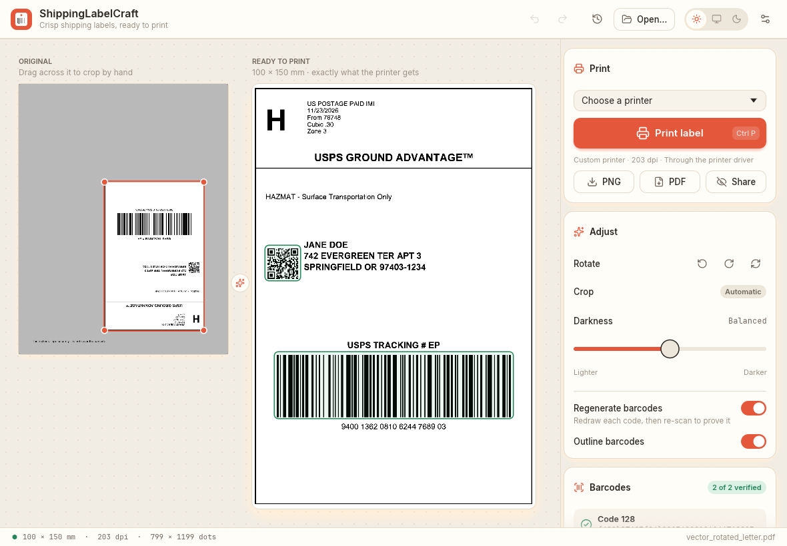
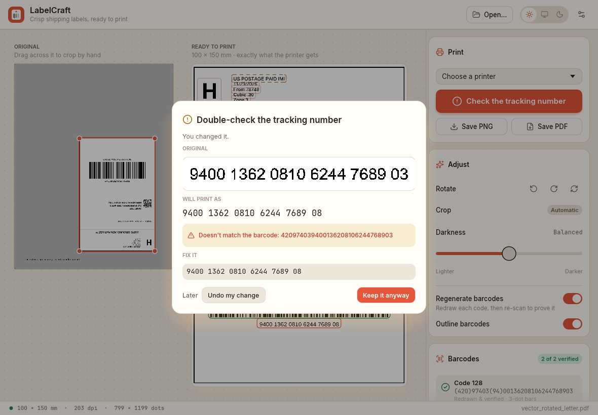

# ShippingLabelCraft

Drop in a shipping label (PDF, PNG or JPG) and get a crisp, print-ready 4 × 6 label for a
thermal printer, then print it straight from the app. Built for the PeriPage PB41, with
profiles for Zebra, Rollo, MUNBYN, DYMO and other popular shipping printers. Windows, macOS
and Linux. *(Called LabelCraft before 0.7.)*

<p>
  
  
</p>

*Shown with a made-up test label.*

## Download

Get the latest from [Releases](https://github.com/civarson/shippinglabelcraft/releases/latest).
None of the downloads are code-signed, so your system warns the first time you open them.

- **Windows:** `shippinglabelcraft-windows-x64-setup.exe` installs just for you (no admin
  rights) with a Start menu shortcut, and optionally a desktop shortcut and "Open with" for
  PDFs and images. The `.zip` has a portable `ShippingLabelCraft.exe` instead.
  SmartScreen: **More info → Run anyway**.
- **macOS** (Apple Silicon and Intel): `shippinglabelcraft-macos-universal.zip`.
  Right-click `ShippingLabelCraft.app` → **Open** the first time.
- **Linux** (x86_64): the `.AppImage` (`chmod +x`, then run it) or the `.tar.gz`.

## What it does

1. **Finds the label.** Letter-size PDFs with instructions, labels with a printed border,
   two-up sheets, multi-page PDFs, screenshots and plain 4 × 6 pages. You can also drag a
   box on the original to crop by hand.
2. **Straightens and rotates it** to portrait, with the main barcode reading left to right.
3. **Fits it to the printer's dots.** PDFs are redrawn from their vector content straight
   onto the printer's dot grid, so text edges land exactly on dots. Images get an adaptive
   black-and-white conversion that keeps faint text.
4. **Regenerates every barcode** it can read (Code 128 / GS1-128 / USPS IMpb, PDF417,
   MaxiCode, Data Matrix, QR, Aztec) with whole-dot bars. A new barcode is only used if it
   scans back to exactly the same data; otherwise the original stays and the app says why.
5. **Prints** through the printer's driver at its real resolution, or, for printers that
   speak ZPL or TSPL, optionally straight in their own language.

**Optional: clean up blurry text (OCR, off by default).** For blurry images and scans,
each line is read twice and redrawn in a clean font only when both reads agree, are
confident, any long number matches a barcode, and the result reads back identically. You
review redrawn text before printing. You can also **click any line to edit it**. Numbers
that are also in a barcode (like the ZIP) can't be changed, and a changed or uncertain
tracking number opens a double-check against the original and the barcode before you can
print.

<p align="center">
  
  
</p>

## Using it

- **Open** a label: drag it onto the window, **Open…** (Ctrl/⌘ O), paste a screenshot or
  copied file (Ctrl/⌘ V), or pick from **Recent** (clock icon).
- Check the **Barcodes** card: green is regenerated and verified, amber kept the original
  (with the reason).
- Pick your printer once, then **Print label** (Ctrl/⌘ P). Undo and redo are in the title
  bar.
- **Several labels in one file** (and packing slips) are listed under *In this file*: click
  one to check it, or **Print all**. Labels whose barcodes don't all verify are skipped.
- **Hands-free:** turn on *Settings → Printing → Watch a folder* and *Print as soon as a
  label is ready*. Download a label and it prints, but only if every barcode verifies.
- **Share** saves a copy with all text and barcodes blurred, for bug reports.
- **Settings** (gear or Ctrl/⌘ ,) cover themes (15, separately for light and dark), label
  size, margins and alignment (with a printable calibration page), image and barcode
  options, OCR, printer model, copies, folder watching, archiving printed labels (with
  automatic clean-up), update notices, and on Windows "Open with".

<p align="center"></p>

### PeriPage PB41 setup

- **Use the SD driver.** PeriPage's "HD" drivers print at 203 × 300 dpi, which stretches the
  image; the SD driver (203 × 203 dpi) keeps barcodes on exact dots. (Thanks to
  [peripage-bridge](https://github.com/hayek/peripage-bridge) for documenting this.)
- **Windows:** the app asks the driver for 100 × 150 mm portrait. If prints come out the
  wrong size, set the driver's default paper to 100 × 150 mm (4 × 6 in) in *Printing
  Preferences*.
- **macOS / Linux:** the app sends `media=Custom.100x150mm` with scaling off. If your driver
  names its 4 × 6 paper differently, add `media=<name>` under *Extra CUPS options*
  (`lpoptions -p <printer> -l` lists the names).

## Printers

The printer is recognised from its name, and the label is drawn at its real resolution and
print width. You can also pick the model in *Settings → Printing*.

| Printer | Resolution | Direct printing | Status |
|---|---|---|---|
| PeriPage PB41 | 203 dpi | driver only | **tested** |
| Zebra (GK420d, ZD411/421, ZD620, ZSB…) | 203 / 300 dpi | ZPL | specs only |
| Rollo (USB / Wireless) | 203 dpi | driver | specs only |
| MUNBYN (ITPP941, RW401/403…) | 203 / 300 dpi | TSPL | specs only |
| iDPRT / Polono (SP410, SP420, PL420…) | 203 / 300 dpi | TSPL | specs only |
| Jadens, Nelko, Phomemo | 203 dpi | driver | specs only |
| DYMO LabelWriter 4XL / 5XL | 300 dpi | driver | specs only |
| Brother QL-1100 / QL-1110 | 300 dpi | driver | specs only |

"Specs only" means nobody has printed on that model with ShippingLabelCraft yet. **Direct
printing** is experimental and off by default. If you try it, *Save a test job* writes the
job to a file, and an issue saying what came out (fine, blank, inverted, upside down)
helps a lot.

## Command line

```
shippinglabelcraft --cli input.pdf out.png              # writes out.png and out.pdf, prints a report
shippinglabelcraft --cli input.jpg out.png --ocr        # also clean up text, listing each line
shippinglabelcraft --cli input.pdf out.png --dpi 300    # draw for a 300 dpi printer
shippinglabelcraft --cli input.pdf out.png --print "PB41"
```

Other options: `--no-regen`, `--no-vector`, `--edit N=text`, `--zpl file`, `--tspl file`,
`--layout`, `--share file`, `--calibration file`, `--capture <printer> <file>`.

## Building

You need Rust (stable), CMake and a C++ compiler (the barcode engine is C++):
`xcode-select --install` and `brew install cmake` on macOS, Visual Studio Build Tools with
*Desktop development with C++* on Windows, `build-essential` and `cmake` on Debian/Ubuntu.

```
cargo build --release
```

Every push to `main` builds all downloads on GitHub Actions. When the `version` in
`Cargo.toml` has no release yet, the same run publishes one, using that version's section
of [CHANGELOG.md](CHANGELOG.md) as the release notes.

## Design

The interface takes its cues from the open-source Crafting Apps, PhotoCraft and SolidCraft
in particular: a native Rust app built on egui, set in Inter and JetBrains Mono, drawn with
Lucide icons and styled from a small set of design tokens. The colours, components and the
"kraft paper & stamp ink" look are ShippingLabelCraft's own; none of SolidCraft's
brand-licensed theme, palette or UI kit is used.

**Not affiliated.** ShippingLabelCraft is an independent hobby project, **not affiliated
with, endorsed by, or connected to** ArtCraft, PhotoCraft, SolidCraft or any of the other
Crafting Apps or their maintainers. The "Craft" in the name and the design choices are a
fan's interpretation of the principles those projects share: native, local-first, open
source and pleasant to use. Seeing those ideas scale so well to small FOSS tools like this
one has been genuinely inspiring, and I'm grateful to the people behind them for building
in the open.

## Contributors

- [Chris Ivarson](https://github.com/civarson): creator and maintainer
- [Claude](https://claude.ai) (Anthropic): co-developer; wrote much of the code with Chris

## License

ShippingLabelCraft is licensed under either the [MIT License](LICENSE-MIT) or the
[Apache License 2.0](LICENSE-APACHE), at your option. Bundled fonts, icons and OCR models
keep their own licenses, listed under Credits.

## Credits

- Barcodes: [zxing-cpp](https://github.com/zxing-cpp/zxing-cpp) with [zint](https://zint.org.uk)
- PDF rendering: [hayro](https://github.com/LaurenzV/hayro); interface: [egui](https://github.com/emilk/egui)
- Text recognition: [PaddleOCR](https://github.com/PaddlePaddle/PaddleOCR) PP-OCRv6 tiny models as packaged by [OnnxOCR](https://github.com/jingsongliujing/OnnxOCR), Apache 2.0 (`assets/ocr/`), run with [rten](https://github.com/robertknight/rten)
- Fonts: [Inter](https://rsms.me/inter/), [JetBrains Mono](https://www.jetbrains.com/lp/mono/) and [Liberation Sans](https://github.com/liberationfonts/liberation-fonts), SIL Open Font License 1.1 (`assets/fonts/`)
- Icons: [Lucide](https://lucide.dev), ISC licence (`assets/icons/LICENSE-lucide.txt`)
- Colour themes follow the published palettes of Catppuccin, Dracula, Nord, Gruvbox, Solarized, Tokyo Night, Rosé Pine, One Dark and GitHub Primer
