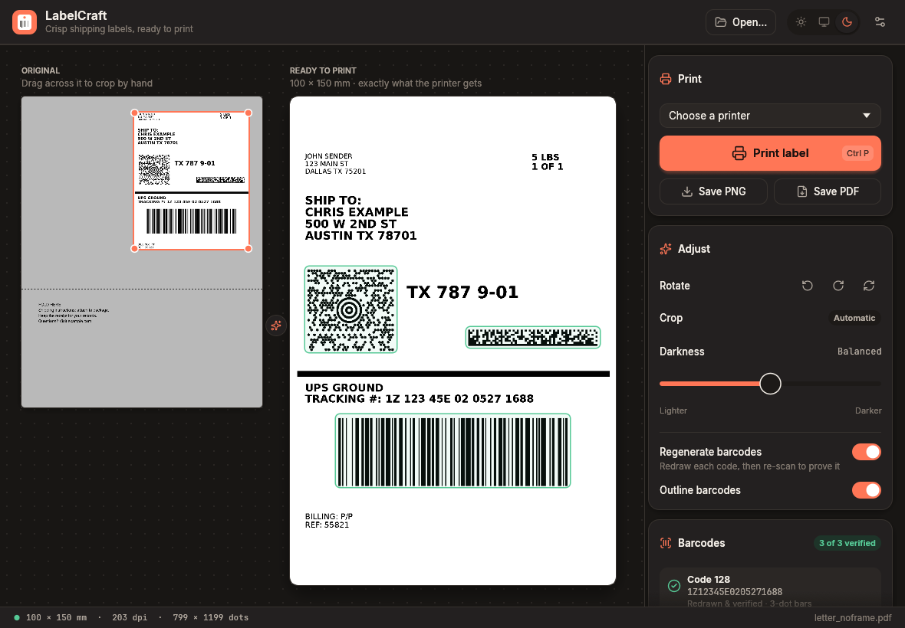
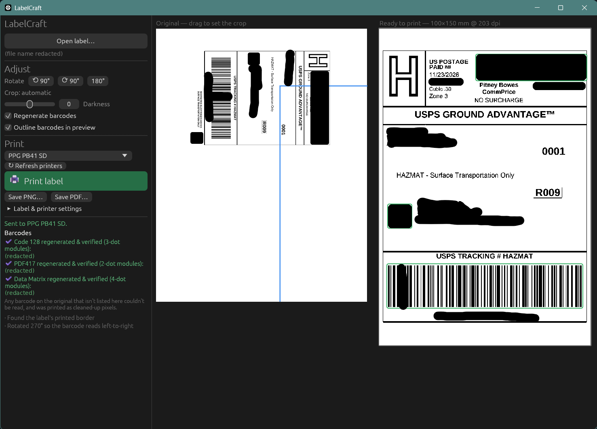

# LabelCraft

Drop in a shipping label (PDF, PNG, or JPG) and get a print-ready 100 × 150 mm label for a
203-dpi thermal printer (built for the PeriPage PB41). Then print it straight from the app.

<p>
  
  
</p>

*Light and dark themes, shown with a made-up test label. It follows your system setting, or pick one with the sun / monitor / moon switch.*

<details>
<summary>On a real USPS Ground Advantage label (personal details blacked out)</summary>



</details>

## What it does

1. **Finds the label on the page.** It handles letter-size PDFs with instructions, labels
   with a printed border, screenshots on a dark background, and plain 4×6 pages. You can
   also drag a box on the original to crop by hand.
2. **Straightens and orients it.** It corrects small skews and turns the label so the main
   barcode reads left-to-right in portrait, including upside-down and landscape sources.
3. **Fits it to the printer's dot grid.** The output is exactly 799 × 1199 dots, converted
   to clean black and white. Vector PDFs use a fixed cut-off, and raster images use an
   adaptive one so faint text survives.
4. **Regenerates the barcodes.** Every barcode that decodes is re-encoded from its exact
   data and redrawn with whole-dot module widths. That covers Code 128 (including
   GS1-128/USPS IMpb), PDF417 (FedEx), MaxiCode (UPS), Data Matrix, QR, and Aztec.
   A new barcode is only kept if it scans back to identical data: the same raw bytes,
   the same symbology identifier, and the same GS1 structure. If it doesn't, the
   original is restored and the panel shows why.
5. **Prints.** On Windows it prints through GDI at the driver's real resolution. On macOS
   it sends an exact-size PDF to CUPS with scaling turned off.

**Text is not re-typeset.** It is cleaned up and snapped to the dot grid, not run through
OCR. A misread character in an address or ZIP code could misroute a package, so the tool
never prints text it guessed.

## Using it

- Drag a file onto the window, click the drop zone, or use **Open…** (Ctrl/⌘-O)
- Check the **Barcodes** list. Green means regenerated and verified. Amber means the
  original was kept, with the reason. If a barcode on the original isn't listed at all,
  it couldn't be read from the source.
- Pick the printer once (it's remembered), then click **Print label** (or press Ctrl/⌘-P).
- The **settings** button (top right) lets you change the label size, the edge margin, and 300 dpi.
- Drag across the original to crop by hand; the **×** next to *Manual* goes back to automatic.

### PeriPage PB41 setup

- **Windows:** install the PeriPage driver. The app asks the driver for 100 × 150 mm
  portrait on every print. If the driver ignores custom sizes, set the default paper
  to 100 × 150 mm (or 4 × 6 in) in *Printing Preferences*.
- **macOS:** install the PeriPage driver and add the printer. The app sends
  `media=Custom.100x150mm` with scaling off. If your driver names its 4×6 paper
  differently, enter it under *Extra CUPS options*, for example `media=<name>`.
  `lpoptions -p <printer> -l` lists the names.

## Command line

```
labelcraft --cli input.pdf out.png              # writes out.png and out.pdf, prints the report
labelcraft --cli input.jpg out.png --no-regen   # clean-up only
labelcraft --cli input.pdf out.png --print "PB41"
```

Set `LABELCRAFT_DEBUG=1` to dump intermediate images and verification crops.

## Design

LabelCraft's interface takes its cues from the open-source Crafting Apps, PhotoCraft and SolidCraft in particular. Like them, it is a native Rust app built on egui, set in Inter and JetBrains Mono, drawn with Lucide icons, and styled entirely from a small set of design tokens, with light and dark themes that can follow the system. The colours, components and the "kraft paper & stamp ink" look are LabelCraft's own: SolidCraft's look is covered by its own brand licence, so none of its theme, palette or UI kit is used here.

### Not affiliated

LabelCraft is an independent hobby project. It is **not affiliated with, endorsed by, or connected to** ArtCraft, PhotoCraft, SolidCraft or any of the other Crafting Apps or their maintainers. The "Craft" in the name and the design choices above are a fan's interpretation of the principles those projects share: native, local-first, open source, and pleasant to use. Seeing that those ideas scale so well to small FOSS tools like this one has been genuinely inspiring, and I'm grateful to the people behind them for building in the open.

## Building

You need Rust (stable), **CMake**, and a C++ compiler, because the zxing-cpp/zint barcode
engine is compiled from source.

- macOS: `xcode-select --install`, then `brew install cmake`
- Windows: Visual Studio Build Tools with *Desktop development with C++* (includes CMake)

```
cargo build --release
```

The first build takes a few minutes (C++).

**Releases:** every push to `main` builds `LabelCraft.exe` (Windows x64) and `LabelCraft.app`
(Apple Silicon) on GitHub Actions. When the `version` in `Cargo.toml` doesn't have a release
yet, the same run publishes one (`v<version>`) with both zips attached, so to ship a new
version, bump the version and push.

The macOS app is ad-hoc signed. On first launch, right-click it and choose **Open**.

## Credits

- [Inter](https://rsms.me/inter/) and [JetBrains Mono](https://www.jetbrains.com/lp/mono/) fonts, SIL Open Font License 1.1 (`assets/fonts/OFL-*.txt`)
- [Lucide](https://lucide.dev) icons, ISC licence (`assets/icons/LICENSE-lucide.txt`)
- Barcode reading and writing by [zxing-cpp](https://github.com/zxing-cpp/zxing-cpp) with [zint](https://zint.org.uk); PDF rendering by [hayro](https://github.com/LaurenzV/hayro); UI by [egui](https://github.com/emilk/egui)

## Layout

| File | Purpose |
|---|---|
| `src/pipeline.rs` | Loading (PDF via hayro, images with EXIF rotation), auto-crop, deskew, orientation, fit, thresholding |
| `src/barcodes.rs` | Detection, isolated-blob second pass, exact re-encoding, verification and rollback |
| `src/print.rs` | Windows GDI printing, CUPS `lp` on macOS/Linux |
| `src/pdfout.rs` | Exact-size 1-bit PDF and PNG with DPI metadata |
| `src/gui.rs` | The window: canvas with the original and the label, inspector cards, toasts, shortcuts |
| `src/theme.rs` | Design tokens (light "Paper" and dark "Night Shift"), fonts, icons |
| `src/widgets.rs` | Hand-drawn controls: cards, buttons, switches, segmented control, logo |
